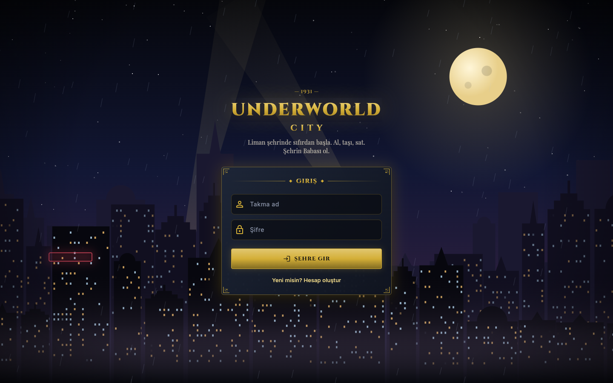
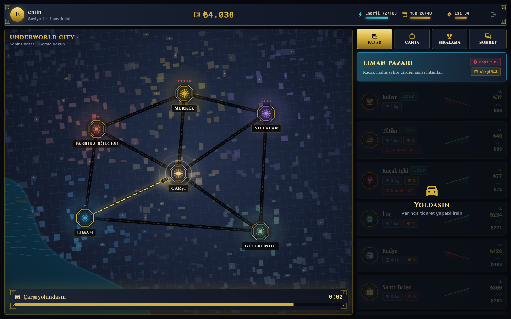
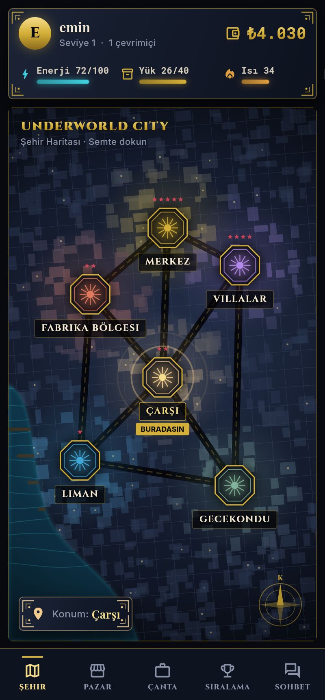
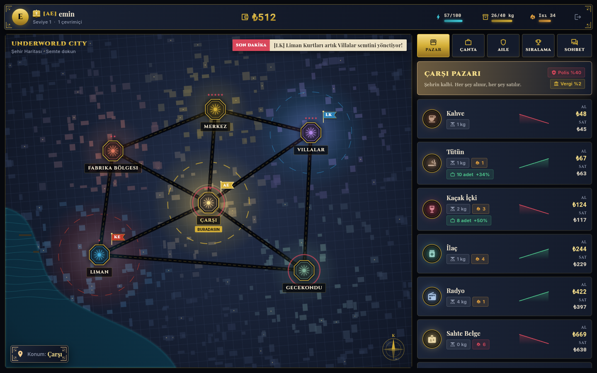
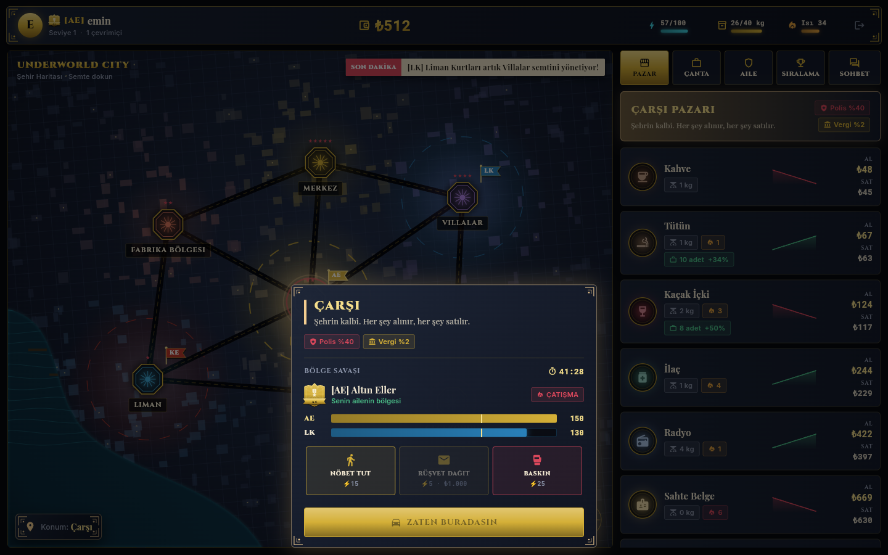
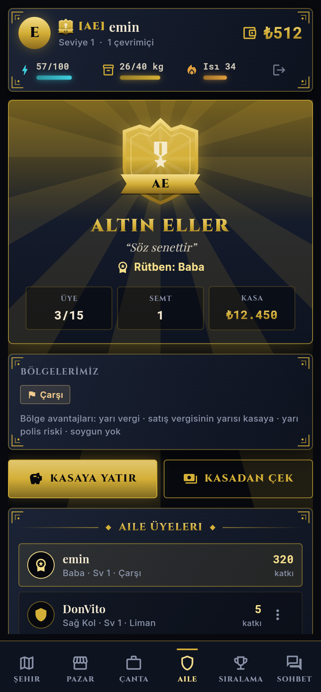
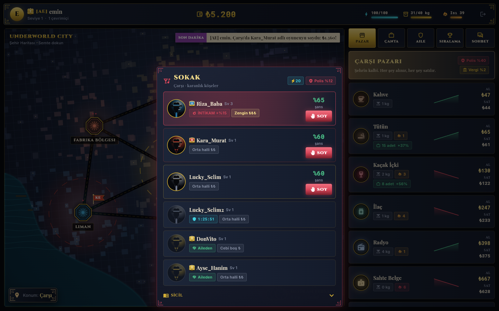
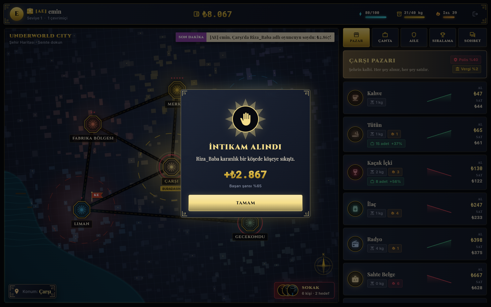
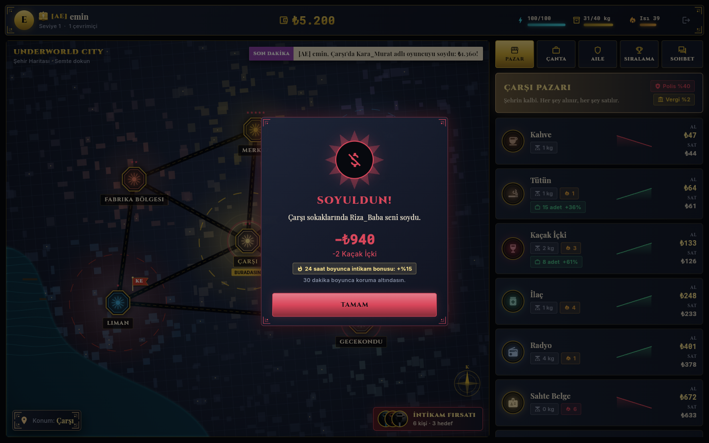

# Underworld City

1931'de, hayali bir liman şehrinde geçen online ticaret ve strateji oyunu. Semtler arasında mal taşıyıp satarsın; yolda polis ve soyguncular seni bekler.

Tasarım planı: [`docs/OYUN_PLANI.md`](docs/OYUN_PLANI.md)

| Giriş | Harita + Pazar | Mobil |
|---|---|---|
|  |  |  |

### Çeteler ve semt kontrolü
| Harita: bölgeler ve bayraklar | Bölge savaşı | Aile (mobil) |
|---|---|---|
|  |  |  |

- ₺2.500'e aile kur ya da var olan bir aileye katıl (en fazla 15 üye). Rütbeler: Baba, Sağ Kol, Kaptan, Asker
- Semtte nüfuz kazanmanın yolları: ticaret (her ₺100 için 1 puan), **Nöbet Tut** (⚡15, +25), **Rüşvet Dağıt** (₺1.000, +45) ve rakibe **Baskın** (⚡25, rakibe -40; polis seni yakalarsa ceza ödersin)
- Her semtte `WAR_ROUND_MINUTES` dakikada bir tur biter. En az 100 nüfuzu olan en güçlü aile semti alır, puanların %30'u bir sonraki tura devreder
- Bölgenin faydaları: yarı vergi, satış vergisinin yarısı aile kasasına, yarı polis riski, soygun yok
- Aile kasası, aile sohbeti, "Son Dakika" haber bandı ve aile sıralaması

### Sokak ve PvP soygun
| Sokak | İntikam alındı | Soyuldun |
|---|---|---|
|  |  |  |

- Haritadaki **SOKAK** butonu, bulunduğun semtteki oyuncuları fötr şapkalı silüetlerle gösterir. Her kartta başarı şansı, ne kadar zengin olduğu, koruma süresi ve intikam durumu yazar
- Soygun 20 enerji ister. Başarı şansı %50'den başlar ve seviye farkı başına ±%5 değişir. Hedefin ailesi semti tutuyorsa -%15, senin ailen tutuyorsa +%10. Seni son 24 saatte soyan birine karşı **intikam** bonusu +%15'tir ve bir kez kullanılır. Şans en az %15, en fazla %85'tir
- Önce polis riski var (semtin polis oranı × 0.3). Yakalanırsan ceza ödersin
- Başarılı soygunda hedefin parasının %10-20'sini (bir üst sınıra kadar) ve rastgele bir malının %25'ini alırsın. Ailen varsa semtte +15 nüfuz kazanırsın. Büyük soygunlar haber bandına düşer
- Koruma: yeni oyuncular ilk 2 saat, soyulanlar 30 dakika korumadadır. Soygun yaparsan kendi koruman biter. Aynı aileden kimse soyulamaz
- Kurban gerçek zamanlı bildirim alır. Oyunda değilse bildirim bir sonraki girişinde gelir. Sicil ekranında yaptığın ve sana yapılan soygunlar listelenir

## Yapı
- `server.js`, `src/`: Node.js + Express + Socket.io + PostgreSQL sunucusu
- `client/`: Flutter istemcisi (web, Android, iOS)

## Çalıştırma

```bash
# 1) Sunucu
cp .env.example .env   # DATABASE_URL ve JWT_SECRET'i doldur
npm install
npm start              # tablolar ve dünya verisi otomatik kurulur

# 2) İstemci (geliştirme)
cd client
flutter pub get
flutter run -d chrome --dart-define=API_URL=http://localhost:3000

# 3) Tek sunucudan yayınlama
cd client && flutter build web --release
# server.js, client/build/web klasörünü otomatik servis eder → http://localhost:3000
```

## API
| Metot | Yol | Açıklama |
|---|---|---|
| POST | `/api/register`, `/api/login` | `{username, password}` → `{token}` |
| GET | `/api/world` | Semtler ve mallar |
| GET | `/api/prices` | Tüm semtlerdeki al/sat fiyatları |
| GET | `/api/me` | Oyuncu durumu (para, enerji, çanta, yolculuk, son olay) |
| POST | `/api/trade` | `{goodId, qty, side: "buy"\|"sell"}` |
| POST | `/api/travel` | `{to}`: başka semte yola çık (10 enerji) |
| GET | `/api/leaderboard` | Servet sıralaması |
| GET | `/api/gangs`, `/api/gangs/:id` | Aile listesi ve detayı (üyeler, kasa, bölgeler) |
| POST | `/api/gangs` | `{name, tag, color, emblem, motto}`: aile kur |
| POST | `/api/gangs/:id/join`, `/api/gang/leave` | Katıl, ayrıl |
| POST | `/api/gang/kick`, `/api/gang/rank` | `{userId}` / `{userId, rank}` (Baba/Sağ Kol) |
| POST | `/api/gang/deposit`, `/api/gang/withdraw` | `{amount}`: kasa |
| GET | `/api/territory` | Semtlerin sahipleri, nüfuz sıralaması, tur bitişi |
| POST | `/api/territory/action` | `{action: "patrol"\|"bribe"\|"raid"}` |
| GET | `/api/news` | Son dakika haberleri |
| GET | `/api/street` | Bulunduğun semtteki oyuncular (şans, koruma, intikam) |
| POST | `/api/rob` | `{targetId}`: soygun |
| GET | `/api/robberies` | Sicil: son soygunlar |

Socket.io olayları: `prices`, `price`, `chat` (`channel: global|gang`), `online`, `arrived`, `territory`, `news`, `gang`, `robbed`.
