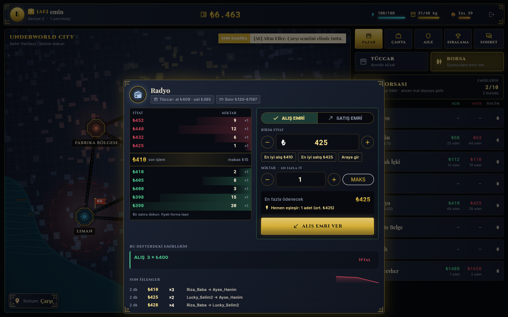
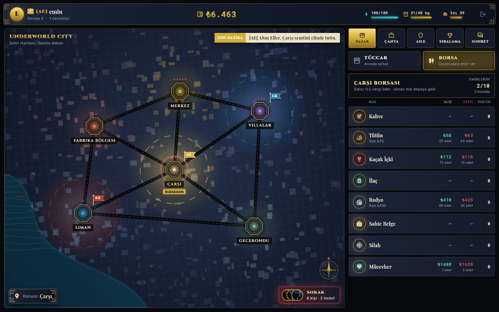
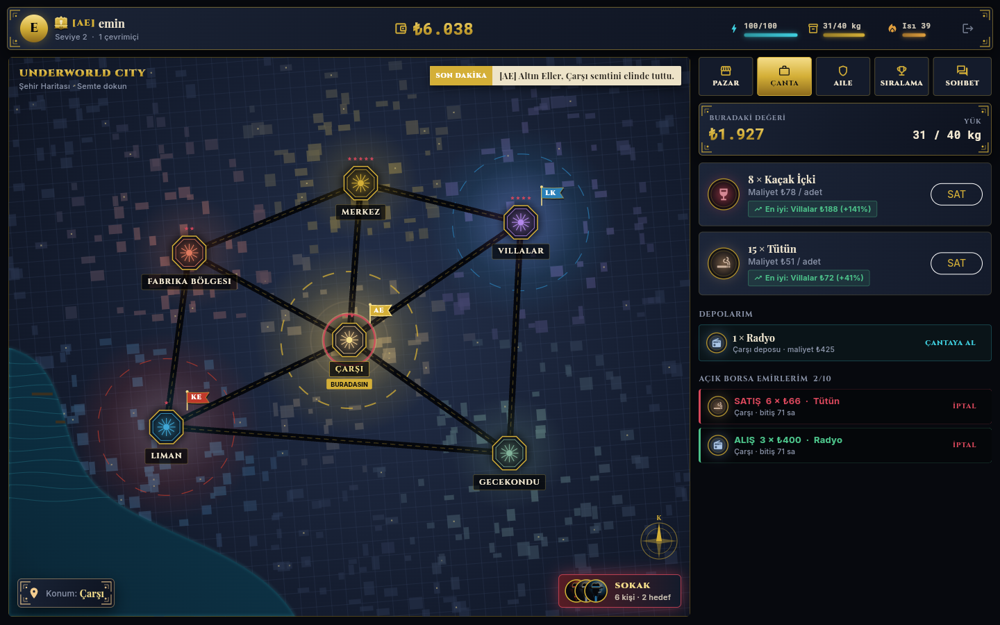
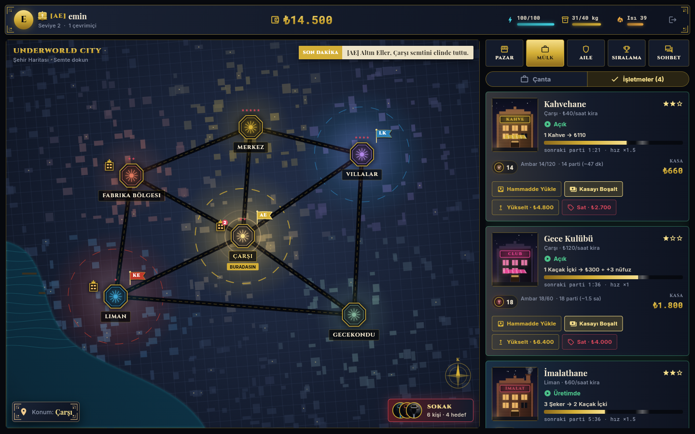
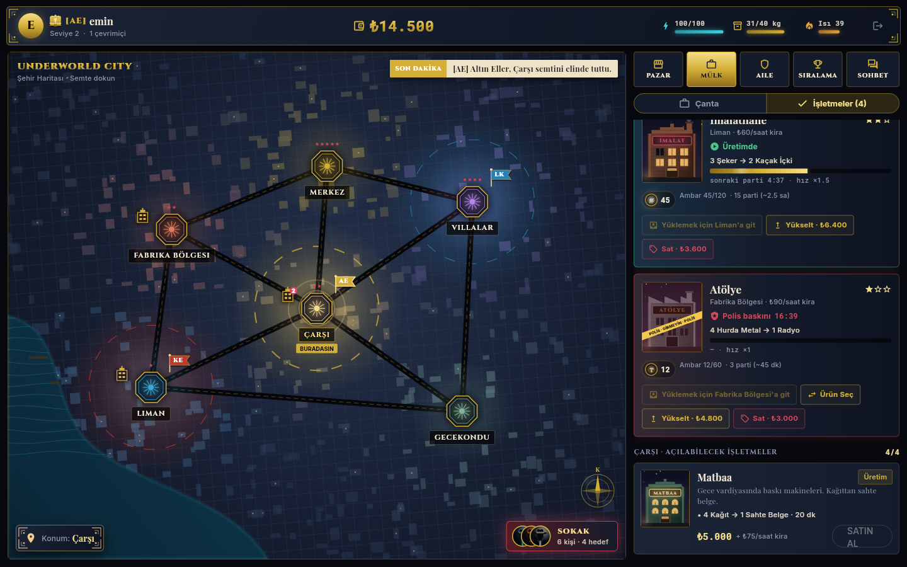
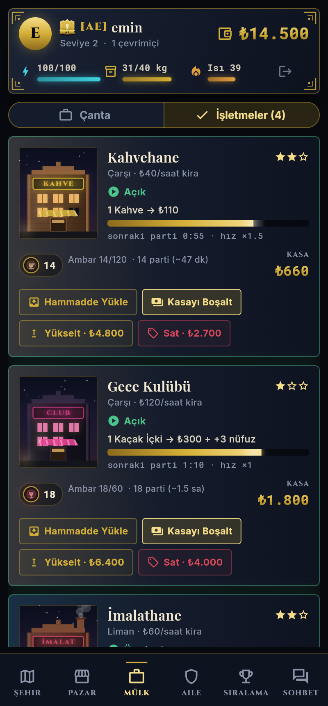

# Underworld City

1931'de, hayali bir liman şehrinde geçen online ticaret ve strateji oyunu. Semtler arasında mal taşıyıp satarsın; yolda polis ve soyguncular seni bekler.

Tasarım planı: [`docs/OYUN_PLANI.md`](docs/OYUN_PLANI.md)

| Giriş | Harita + Pazar | Mobil |
|---|---|---|
|  |  |  |

### Çeteler ve semt kontrolü
| Harita: bölgeler ve bayraklar | Bölge savaşı | Aile (mobil) |
|---|---|---|
|  |  |  |

- ₺2.500'e aile kur ya da var olan bir aileye katıl (en fazla 15 üye). Rütbeler: Baba, Sağ Kol, Kaptan, Asker
- Semtte nüfuz kazanmanın yolları: ticaret (her ₺100 için 1 puan), **Nöbet Tut** (⚡15, +25), **Rüşvet Dağıt** (₺1.000, +45) ve rakibe **Baskın** (⚡25, rakibe -40; polis seni yakalarsa ceza ödersin)
- Her semtte `WAR_ROUND_MINUTES` dakikada bir tur biter. En az 100 nüfuzu olan en güçlü aile semti alır, puanların %30'u bir sonraki tura devreder
- Bölgenin faydaları: yarı vergi, satış vergisinin yarısı aile kasasına, yarı polis riski, soygun yok
- Aile kasası, aile sohbeti, "Son Dakika" haber bandı ve aile sıralaması

### Sokak ve PvP soygun
| Sokak | İntikam alındı | Soyuldun |
|---|---|---|
|  |  |  |

- Haritadaki **SOKAK** butonu, bulunduğun semtteki oyuncuları fötr şapkalı silüetlerle gösterir. Her kartta başarı şansı, ne kadar zengin olduğu, koruma süresi ve intikam durumu yazar
- Soygun 20 enerji ister. Başarı şansı %50'den başlar ve seviye farkı başına ±%5 değişir. Hedefin ailesi semti tutuyorsa -%15, senin ailen tutuyorsa +%10. Seni son 24 saatte soyan birine karşı **intikam** bonusu +%15'tir ve bir kez kullanılır. Şans en az %15, en fazla %85'tir
- Önce polis riski var (semtin polis oranı × 0.3). Yakalanırsan ceza ödersin
- Başarılı soygunda hedefin parasının %10-20'sini (bir üst sınıra kadar) ve rastgele bir malının %25'ini alırsın. Ailen varsa semtte +15 nüfuz kazanırsın. Büyük soygunlar haber bandına düşer
- Koruma: yeni oyuncular ilk 2 saat, soyulanlar 30 dakika korumadadır. Soygun yaparsan kendi koruman biter. Aynı aileden kimse soyulamaz
- Kurban gerçek zamanlı bildirim alır. Oyunda değilse bildirim bir sonraki girişinde gelir. Sicil ekranında yaptığın ve sana yapılan soygunlar listelenir

### Oyuncular arası borsa
| Emir defteri | Borsa listesi | Depo ve emirler |
|---|---|---|
|  |  |  |

- Pazar sekmesinde iki mod var: **Tüccar** (NPC'den anında al/sat) ve **Borsa** (oyunculara limit emir ver)
- Her semtin her mal için ayrı bir emir defteri var, yani EVE'deki gibi bölgesel fiyatlar. Fiyat-zaman önceliği geçerli ve işlem defterde bekleyen emrin fiyatından gerçekleşir
- Alış emrinde para emanete alınır. Satış emrinde mal önce çantadan, sonra o semtteki depodan ayrılır
- Satın alınan mal o semtteki **depoya** teslim edilir. Oradayken çantana alırsın (kapasite sınırı geçerli)
- Satıcı semtin satış vergisini öder (kendi bölgende yarı vergi) ve bölgeyi tutan aile verginin yarısını kasaya alır. Aile üyelerinin borsa işlemleri de nüfuz kazandırır
- Fiyat sınırı semtteki tüccar fiyatının %30'u ile 3 katı arasındadır. Kişi başı en fazla 10 açık emir olabilir. Emirler 72 saat sonra iptal olur ve emanetteki para ya da mal iade edilir
- Defterde derinlik çubukları, makas, son işlemler ve bir fiyat grafiği var. Forma girdiğin emrin hemen ne kadar eşleşeceği önceden gösterilir. Emrin dolunca anında bildirim gelir

### İşletmeler ve üretim
| İşletmeler | Polis baskını | Mobil |
|---|---|---|
|  |  |  |

| İşletme | Tür | Semtler | Üretim |
|---|---|---|---|
| İmalathane | Üretim | Liman, Fabrika, Gecekondu | 3 Şeker → 1 Kaçak İçki (30 dk) |
| Atölye | Üretim | Fabrika, Gecekondu | 6 Hurda → 1 Radyo (1 sa) · 6 Hurda + 1 Radyo → 1 Silah (2 sa) |
| Matbaa | Üretim | Fabrika, Çarşı, Merkez | 8 Kağıt → 1 Sahte Belge (4 sa) |
| Kahvehane | Paravan | Liman, Çarşı, Gecekondu, Merkez | 4 Kahve → ₺255 kasaya (1 sa) |
| Gece Kulübü | Paravan | Villalar, Merkez, Çarşı | 3 Kaçak İçki → ₺560 kasaya + 4 nüfuz (1 sa) |

- Yeni ham maddeler: **Şeker** (Liman'da ucuz), **Hurda Metal** (Gecekondu'da ucuz), **Kağıt** (Fabrika'da ucuz)
- Ham maddeyi işletmeye o semtteyken yüklersin (çantandan ya da o semtteki depodan). Üretilen mal o semtteki depoya gider, paravan işletmeler parayı kasaya yazar
- Kira saatlik ve peşin ödenir. Paran yetmezse üretim durur, para gelince kaldığı yerden devam eder
- 3 seviye var. Hız ×1, ×1.5 ve ×2.2 olur, ambar 60, 120 ve 240 birime çıkar. Satarsan yatırımın yarısı ve kasadaki para geri gelir
- Kaçak mal üreten işletmelere polis baskını yapabilir: ham maddenin yarısına el konur ve işletme 30 dakika kapanır. Kendi ailenin bölgesinde risk yarıya iner
- Kişi başı en fazla 4 işletme olabilir. Haritada işletmelerinin olduğu semtlerde bina simgesi görünür

### Ekonomi dengesi
Tüm fiyatlar, kazançlar ve süreler [`src/economy.js`](src/economy.js) dosyasında. Ticarium, TürkMafya, Torn ve EVE araştırmasına dayanan hedefler ve önce/sonra karşılaştırması [`docs/EKONOMI.md`](docs/EKONOMI.md) içinde. Bir sayıyı değiştirdikten sonra şu komutla kontrol et:

```bash
node scripts/economy-sim.js
```

## Yapı
- `server.js`, `src/`: Node.js + Express + Socket.io + PostgreSQL sunucusu
- `client/`: Flutter istemcisi (web, Android, iOS)

## Çalıştırma

```bash
# 1) Sunucu
cp .env.example .env   # DATABASE_URL ve JWT_SECRET'i doldur
npm install
npm start              # tablolar ve dünya verisi otomatik kurulur

# 2) İstemci (geliştirme)
cd client
flutter pub get
flutter run -d chrome --dart-define=API_URL=http://localhost:3000

# 3) Tek sunucudan yayınlama
cd client && flutter build web --release
# server.js, client/build/web klasörünü otomatik servis eder → http://localhost:3000
```

## API
| Metot | Yol | Açıklama |
|---|---|---|
| POST | `/api/register`, `/api/login` | `{username, password}` → `{token}` |
| GET | `/api/world` | Semtler ve mallar |
| GET | `/api/prices` | Tüm semtlerdeki al/sat fiyatları |
| GET | `/api/me` | Oyuncu durumu (para, enerji, çanta, yolculuk, son olay) |
| POST | `/api/trade` | `{goodId, qty, side: "buy"\|"sell"}` |
| POST | `/api/travel` | `{to}`: başka semte yola çık (10 enerji) |
| GET | `/api/leaderboard` | Servet sıralaması |
| GET | `/api/gangs`, `/api/gangs/:id` | Aile listesi ve detayı (üyeler, kasa, bölgeler) |
| POST | `/api/gangs` | `{name, tag, color, emblem, motto}`: aile kur |
| POST | `/api/gangs/:id/join`, `/api/gang/leave` | Katıl, ayrıl |
| POST | `/api/gang/kick`, `/api/gang/rank` | `{userId}` / `{userId, rank}` (Baba/Sağ Kol) |
| POST | `/api/gang/deposit`, `/api/gang/withdraw` | `{amount}`: kasa |
| GET | `/api/territory` | Semtlerin sahipleri, nüfuz sıralaması, tur bitişi |
| POST | `/api/territory/action` | `{action: "patrol"\|"bribe"\|"raid"}` |
| GET | `/api/news` | Son dakika haberleri |
| GET | `/api/street` | Bulunduğun semtteki oyuncular (şans, koruma, intikam) |
| POST | `/api/rob` | `{targetId}`: soygun |
| GET | `/api/robberies` | Sicil: son soygunlar |
| GET | `/api/market/summary/:districtId` | Semt borsası: en iyi alış/satış, hacim, son fiyat |
| GET | `/api/market/book/:districtId/:goodId` | Emir defteri, son işlemler, emirlerin, depo |
| POST | `/api/market/order` | `{goodId, side, price, qty}`: limit emir (eşleşir, kalanı deftere yazılır) |
| POST | `/api/market/cancel` | `{orderId}` |
| GET | `/api/market/orders`, `/api/storage` | Açık emirlerin, depoların |
| POST | `/api/storage/collect` | `{goodId, qty?}`: depodan çantaya |
| GET | `/api/business/types` | İşletme türleri, tarifler, semtler |
| GET | `/api/businesses` | İşletmelerin (kira ve üretim hesaplanmış durumda) |
| POST | `/api/business/buy` | `{type}`: bulunduğun semtte işletme aç |
| POST | `/api/business/:id/load` | `{goodId, qty}`: ham madde yükle |
| POST | `/api/business/:id/recipe` | `{recipeId}` |
| POST | `/api/business/:id/collect`, `/upgrade`, `/sell` | Kasayı boşalt, yükselt, sat |

Socket.io olayları: `prices`, `price`, `chat` (`channel: global|gang`), `online`, `arrived`, `territory`, `news`, `gang`, `robbed`, `book`, `order_filled`, `order_expired`, `business_raid`.
